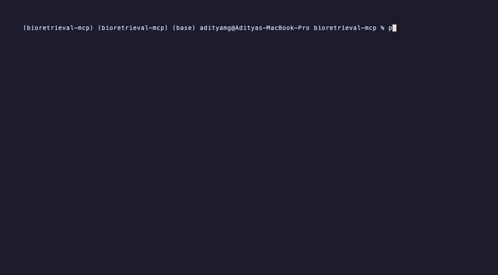

# bioretrieval-mcp

An [MCP](https://modelcontextprotocol.io) server that gives LLM agents typed access to cryo-EM, protein, and
DNA-methylation research tools: EMDB search, UniProt lookups, ESM-2 embeddings, **sequence-to-cryo-EM-map
retrieval with a trained two-tower model**, and GEO methylation-array search. It comes with a 40-question
eval run with Claude as the MCP client.



## Tools

| Tool | What it does | Backend |
|---|---|---|
| `search_emdb(query, resolution_max?, limit?)` | Keyword or Solr search over EMDB; returns resolution, method, organisms, fitted PDBs, UniProt xrefs, Pfam, microscope, citation | EBI EMDB API |
| `get_uniprot(accession)` | Sequence, curated function, Pfam families, genes, organism, review status, EMDB xrefs | UniProt REST |
| `embed_sequence(sequence, include_vector?)` | ESM-2 650M (`esm2_t33_650M_UR50D`) final-layer mean-pooled 1280-d embedding, cached on disk | local, torch |
| `retrieve_maps(sequence, k?)` | Top-k cryo-EM maps for a protein sequence from the two-tower retrieval model, with cosine scores | local, torch |
| `search_geo_methylation(query, platform)` | GEO series on `27K` / `450K` / `EPIC` / `EPICv2` arrays, with sample counts, dates, PubMed IDs | NCBI E-utilities |
| `cpgpt_embed(sample_id)` *(optional)* | Precomputed CpGPT sample embedding, registered only when an embedding store is configured | local |

Every tool has a typed JSON input schema (ranges, enums, required fields) and a typed `outputSchema`, so
clients get `structuredContent` as well as text. Tools are annotated read-only/idempotent.

Platform to GPL mapping used by `search_geo_methylation` (checked against the GEO platform records):
27K = GPL8490; 450K = GPL13534, GPL16304; EPIC = GPL21145, GPL23976; EPICv2 = GPL33022.

## Quick start

```bash
uv venv && uv pip install -e ".[ml,dev]"      # drop [ml] for the API-only tools

# stdio (Claude Desktop / Claude Code / any MCP client)
bioretrieval-mcp

# streamable HTTP
bioretrieval-mcp --transport streamable-http --port 8000   # served at http://127.0.0.1:8000/mcp
```

Claude Code: `claude mcp add bioretrieval -- /path/to/.venv/bin/bioretrieval-mcp`

Claude Desktop (`claude_desktop_config.json`):

```json
{
  "mcpServers": {
    "bioretrieval": {
      "command": "/path/to/.venv/bin/bioretrieval-mcp",
      "env": {
        "BIORETRIEVAL_MAP_INDEX": "/path/to/map_index.npz",
        "BIORETRIEVAL_RETRIEVAL_CHECKPOINT": "/path/to/best.pt"
      }
    }
  }
}
```

Docker:

```bash
docker build -t bioretrieval-mcp .                    # API tools only
docker build --target ml -t bioretrieval-mcp:ml .     # + ESM-2 / retrieval (CPU torch)
docker run -p 8000:8000 -v bioretrieval-data:/data bioretrieval-mcp
```

## Configuration

| Env var | Default | Purpose |
|---|---|---|
| `BIORETRIEVAL_CACHE_DIR` | `~/.cache/bioretrieval-mcp` | HTTP response cache (SQLite) and ESM embedding cache |
| `BIORETRIEVAL_HTTP_TIMEOUT_S` | `20` | Per-request timeout |
| `BIORETRIEVAL_HTTP_MAX_RETRIES` | `3` | Retries on timeouts, connection errors, 408/425/429/5xx |
| `BIORETRIEVAL_HTTP_CACHE_TTL_S` | `86400` | Response cache TTL |
| `BIORETRIEVAL_MAP_INDEX` | unset | Map index `.npz`; enables `retrieve_maps` |
| `BIORETRIEVAL_RETRIEVAL_CHECKPOINT` | unset | Two-tower checkpoint (sequence tower) |
| `BIORETRIEVAL_CPGPT_EMBEDDINGS` | unset | CpGPT embedding store; enables `cpgpt_embed` |
| `BIORETRIEVAL_DEVICE` | `auto` | `cuda` / `mps` / `cpu` |
| `NCBI_API_KEY`, `BIORETRIEVAL_NCBI_EMAIL` | unset | NCBI identification; the key raises the rate limit from 3 to 10 req/s |

## Retrieval model

`retrieve_maps` serves the sequence tower of the multimodal model from the companion paper (ESM-2 650M sequence
encoder, 3D-CNN volume encoder, shared 512-d latent space, trained with JEPA prediction + symmetric InfoNCE +
VICReg on human EMDB maps). Only the sequence tower runs at query time; map embeddings are computed offline by
the volume tower and shipped as an index:

```bash
# 1. on the GPU box: encode every map with the volume tower -> map_emb.npy (N x 512), rows = metadata order
# 2. package it
python scripts/build_map_index.py two-tower --embeddings map_emb.npy \
    --metadata metadata_curated.csv --model "JEPA+InfoNCE two-tower" --out map_index.npz --fetch-titles
# 3. serve
BIORETRIEVAL_MAP_INDEX=map_index.npz BIORETRIEVAL_RETRIEVAL_CHECKPOINT=best.pt bioretrieval-mcp
```

The checkpoint loader autodetects both trainer formats in the research repo (`mmprotein` trainer:
`model_state_dict` / `seq_projector`; end-to-end trainers: `model` / `sequence_projection`, including
fine-tuned ESM-2 weights when present) and rebuilds the projection head from the weight shapes.

Without a checkpoint, `build_map_index.py esm-baseline` builds an index where each map is represented by the
ESM-2 embedding of its paired UniProt sequence. Retrieval then reduces to sequence nearest-neighbour search.
The tool reports which model produced each result, so agents and users can tell them apart.

## Engineering

- **Transports**: stdio and streamable HTTP (both exercised in the test suite with a real server subprocess).
- **Caching**: SQLite TTL cache for upstream responses; ESM embeddings cached on disk by sequence hash
  (cold 183-residue embedding about 7 s on Apple M-series including model load; cache hits return immediately).
- **Resilience**: per-request timeouts, exponential backoff with jitter, `Retry-After` support, per-host pacing
  for NCBI's rate limit. Upstream failures come back as MCP tool errors (`isError: true`) with an
  agent-readable message instead of crashing the session.
- **Validation**: UniProt accession regex, amino-acid alphabet and length checks (DNA input is rejected with a
  hint), Solr query sanitisation, bounded `k` / `limit` / `resolution_max`, enum-typed platforms. Invalid
  input is rejected before any network call.
- **Tests**: 89 pytest tests, all upstream APIs mocked with `httpx.MockTransport` and recorded fixtures. The
  GitHub Actions workflow runs them on Python 3.10/3.12/3.13 and adds a Docker build + HTTP smoke test.

```bash
pytest                 # offline, a few seconds
```

## Evaluation

40 research questions (`eval/questions.jsonl`) across UniProt (10), EMDB (9), GEO methylation (9),
embeddings (3), retrieval (5), and multi-tool chains (4). Each has a gold answer, deterministic key-fact checks,
and the tool calls that ground it. `eval/verify_gold.py` re-runs those calls against the live sources and
confirms every gold fact is present in current tool output, so no gold answer depends on model memory.

Claude (`claude-opus-5-5`) is the MCP client: it sees exactly the tool list the server advertises and every
call goes over a real stdio MCP session.

| Metric | Definition |
|---|---|
| Tool-selection accuracy | All tools required by the question were called (also: first-call accuracy, call precision) |
| Answer correctness | Claude judge vs gold answer (`correct` / `partially_correct` / `incorrect`); plus deterministic key-fact checks |
| Faithfulness | Ragas definition: answer split into atomic claims, each checked for support in the context the agent had (the tool descriptions it was shown plus the tool outputs it received); supported / total |

```bash
python eval/verify_gold.py                       # ground-truth check, no LLM
python eval/run_eval.py --out eval/results/run.jsonl
python eval/score.py eval/results/run.jsonl      # writes run.scores.json and run.summary.md
```

### Results

Agent `claude-opus-5-5` (effort `medium`), grader `claude-opus-5-5`, gold snapshot 2026-10-21, one run.
`retrieve_maps` used the **ESM-2 baseline index**, not the trained two-tower model (see below).

| slice | n | tool selection | first call | call precision | key facts | judge correct | correct or partial | faithfulness |
|---|---|---|---|---|---|---|---|---|
| **all** | 40 | 100.0% | 100.0% | 100.0% | 100.0% | 100.0% | 100.0% | 0.912 |
| uniprot | 10 | 100.0% | 100.0% | 100.0% | 100.0% | 100.0% | 100.0% | 0.873 |
| emdb | 9 | 100.0% | 100.0% | 100.0% | 100.0% | 100.0% | 100.0% | 0.949 |
| geo | 9 | 100.0% | 100.0% | 100.0% | 100.0% | 100.0% | 100.0% | 0.923 |
| embed | 3 | 100.0% | 100.0% | 100.0% | 100.0% | 100.0% | 100.0% | 0.832 |
| retrieval | 5 | 100.0% | 100.0% | 100.0% | 100.0% | 100.0% | 100.0% | 0.929 |
| multi | 4 | 100.0% | 100.0% | 100.0% | 100.0% | 100.0% | 100.0% | 0.944 |

60 tool calls in total (1.5 per question), 1 tool error (q10's deliberate lookup of a nonexistent accession,
which the agent reported correctly). Median latency 8.8 s per question, p90 16.4 s. One of 120 grading calls was
declined by a safety classifier and re-run on `claude-opus-5` via server-side fallback.

**What the numbers say, and what they don't.**

- *Faithfulness is the informative metric here, and 0.912 is conservative.* 72 of 1,021 answer claims (7.1%)
  were marked unsupported. They fall into two groups:
  - **Background knowledge the agent added** despite being told to ground every statement: protein biology
    (preproinsulin structure, mTOR domain positions) and general advice ("UniProt sometimes merges accessions",
    q10 at 0.33).
  - **Grader false negatives.** 44 of the 72 contain accessions, and every one of those accessions appears in
    the tool output the agent received. Spot checks (q15, q20, q33, q36, q37) confirmed the stated facts were
    in the output, so the true faithfulness is higher. The score is reported as graded, without heuristic
    correction.
- *Tool selection and correctness are at ceiling, so this set does not separate good from great.* Most questions
  need one or two tool calls with clear routing cues. A harder set (ambiguous routing, longer chains, questions
  that should be refused or need clarification) is the obvious next step.
- *Retrieval questions mostly test plumbing.* With the baseline index, a query whose exact sequence is in the
  index scores 1.0 against its own maps, so these 5 questions check that the agent chains UniProt to retrieval
  correctly, not that the trained model retrieves well. Retrieval quality is reported in the paper
  (median rank 2 to 3 over 3,275 maps).
- *Grader and agent are the same model,* which can bias grading in the agent's favour. The deterministic
  key-fact checks (100%) do not depend on the grader and agree with it.

**Eval corrections after the first run (disclosed).** The first scoring pass gave 97.5% tool selection,
95.0% judge-correct and 0.905 faithfulness (`eval/results/run.v1.summary.md`). Reviewing the misses showed
three problems with the eval, not the agent, which are fixed in `questions.jsonl` (see each item's `gold_note`):

1. **q22:** the gold answer counted all 11 GEO hits as ovarian-cancer studies. The agent correctly excluded a
   cholangiocarcinoma series (GSE38860) and a SuperSeries duplicate, reporting 9.
2. **q26:** the gold answer treated every EPICv2 "placenta" hit as placental. The agent correctly identified
   a macrophage study and a twins study as off-topic.
3. **q31:** the question is answerable from `embed_sequence`'s advertised description (1,022-residue limit),
   so calling that tool became optional. Faithfulness now also counts tool descriptions as context, since the
   agent legitimately reads them.

The agent was not re-run; only the grading changed. The eval also surfaced a product fix:
`embed_sequence`'s description does not say *which* 1,022 residues it keeps (it keeps the first), so in q31 the
agent had to guess.

## Layout

```
src/bioretrieval_mcp/
  server.py          tool definitions, transports, entry point
  http.py cache.py   retrying cached HTTP client
  validation.py      input validation
  schemas.py         typed tool outputs
  sources/           emdb.py, uniprot.py, geo.py
  ml/                esm.py (ESM-2 + cache), retrieval.py (two-tower), cpgpt.py
scripts/             build_map_index.py, export_cpgpt_embeddings.py
eval/                questions.jsonl, run_eval.py, score.py, verify_gold.py, demo.py
tests/               pytest suite + recorded API fixtures
```
